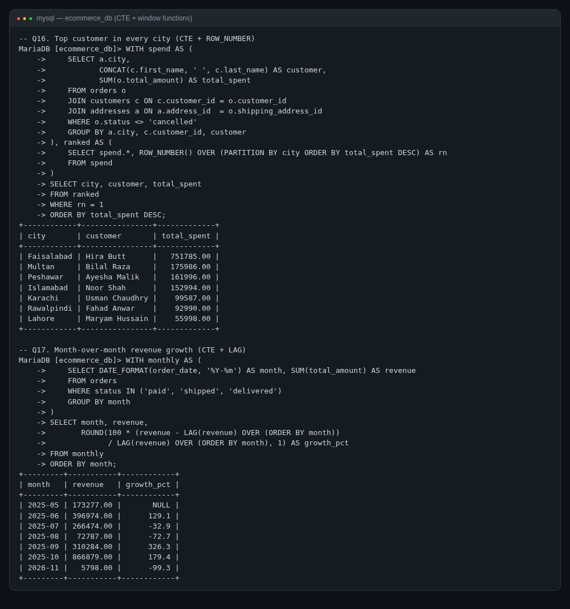
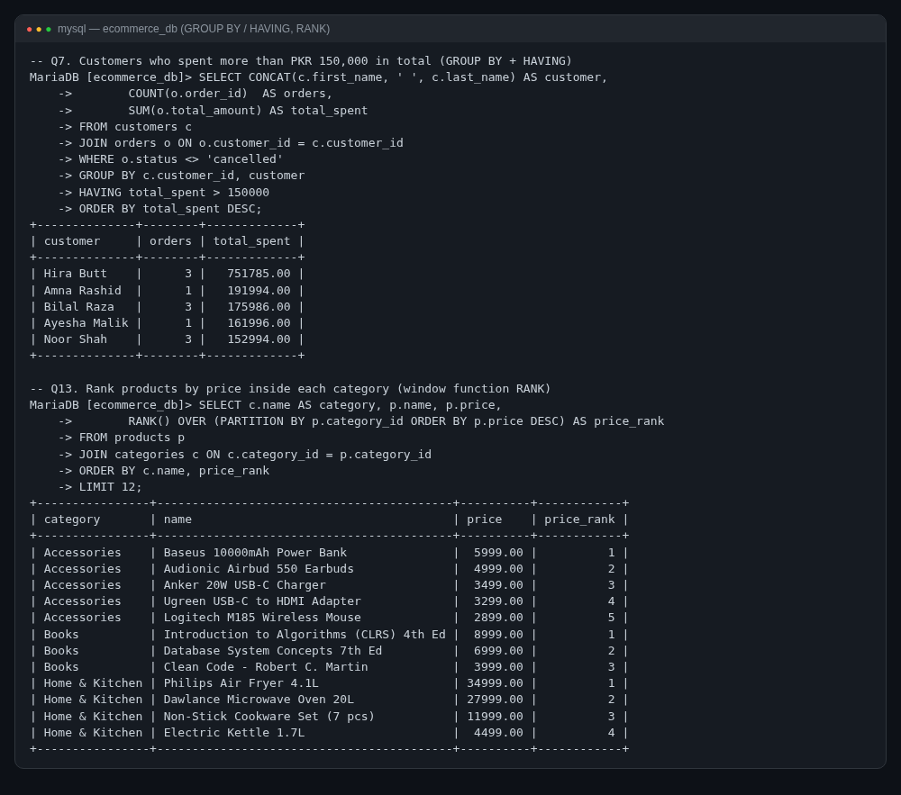
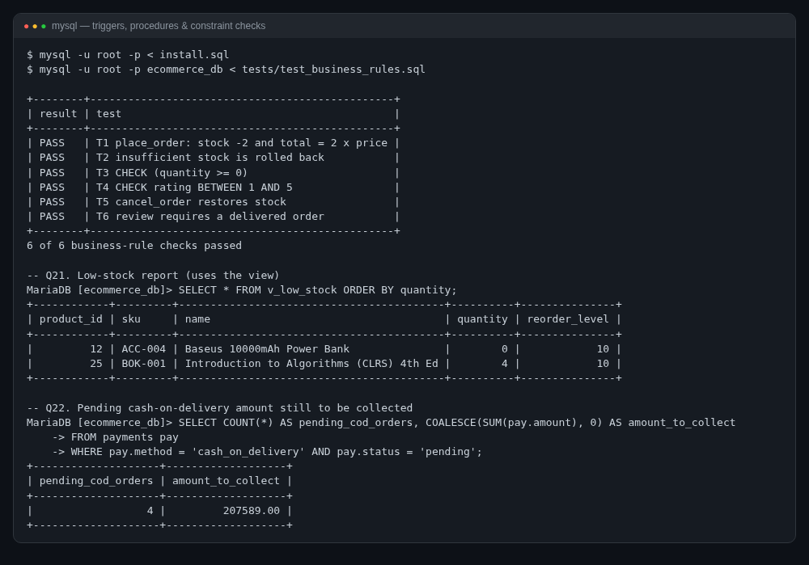

# E-Commerce Database System

A fully normalized **MySQL 8 / MariaDB** database for an online store — schema, realistic seed data, views, stored procedures, triggers and 24 documented SQL queries, all tested end to end.


Built for my **Database Systems** course. The same schema is designed to be the back end of a full-stack e-commerce app later, so I kept it clean, constrained and documented.

## Features

- **9 tables**: customers, addresses, categories (with sub-categories), products, inventory, orders, order_items, payments, reviews
- **Integrity in the database, not just the app**: primary/foreign keys, `UNIQUE`, `CHECK` constraints (price > 0, stock ≥ 0, rating 1–5, valid email shape), `ENUM` statuses
- **Indexes** on every foreign key and on common filters (`orders(customer_id, order_date)`, `orders(status)`, `products(name)`)
- **Triggers**
  - refuse an order line when stock is insufficient
  - decrement stock and update the order total automatically
  - restore stock if an order line is deleted
  - only allow reviews from customers whose order was delivered
- **Stored procedures**
  - `place_order` — one transaction: order + item + payment, rolled back completely on any error
  - `cancel_order` — restocks every line, refunds/voids payments, marks the order cancelled
  - `restock_product`
- **Views**: `v_order_summary`, `v_product_catalog` (stock + average rating), `v_low_stock`
- **Seed data**: 22 customers, 10 categories, 30 products (prices in PKR), 40 orders with 85 order lines, 40 payments, 32 reviews — totals and stock are produced by the triggers, not typed by hand
- **24 commented queries**: joins, self-joins, GROUP BY / HAVING, correlated & `NOT EXISTS` subqueries, `CASE`, window functions (`RANK`, `ROW_NUMBER`, `LAG`, running `SUM`), and CTEs
- **Business-rule test script** that proves the triggers, procedures and constraints work (6/6 pass)

## Tech Stack

| Part | Technology |
|---|---|
| Database | MySQL 8.0+ or MariaDB 10.6+ (InnoDB, utf8mb4) |
| Language | SQL (DDL, DML, PL/SQL-style procedures & triggers) |
| Diagram | Mermaid ER diagram (renders on GitHub) |

## ER Diagram

```mermaid
erDiagram
    CUSTOMERS ||--o{ ADDRESSES : has
    CUSTOMERS ||--o{ ORDERS : places
    CUSTOMERS ||--o{ REVIEWS : writes
    ADDRESSES |o--o{ ORDERS : "ships to"
    CATEGORIES |o--o{ CATEGORIES : "parent of"
    CATEGORIES ||--o{ PRODUCTS : groups
    PRODUCTS ||--|| INVENTORY : "stock of"
    PRODUCTS ||--o{ ORDER_ITEMS : "appears in"
    PRODUCTS ||--o{ REVIEWS : receives
    ORDERS ||--|{ ORDER_ITEMS : contains
    ORDERS ||--o{ PAYMENTS : "paid by"

    CUSTOMERS {
        int customer_id PK
        varchar first_name
        varchar last_name
        varchar email UK
        varchar phone
        char password_hash
        datetime created_at
        boolean is_active
    }
    ADDRESSES {
        int address_id PK
        int customer_id FK
        varchar label
        varchar line1
        varchar city
        varchar province
        varchar postal_code
        boolean is_default
    }
    CATEGORIES {
        int category_id PK
        varchar name UK
        int parent_id FK
    }
    PRODUCTS {
        int product_id PK
        int category_id FK
        varchar sku UK
        varchar name
        decimal price "CHECK > 0"
        boolean is_active
    }
    INVENTORY {
        int product_id PK, FK
        int quantity "CHECK >= 0"
        int reorder_level
    }
    ORDERS {
        int order_id PK
        int customer_id FK
        int shipping_address_id FK
        datetime order_date
        enum status
        decimal total_amount
    }
    ORDER_ITEMS {
        int order_id PK, FK
        int product_id PK, FK
        int quantity "CHECK > 0"
        decimal unit_price
    }
    PAYMENTS {
        int payment_id PK
        int order_id FK
        enum method
        decimal amount
        enum status
        datetime paid_at
    }
    REVIEWS {
        int review_id PK
        int product_id FK
        int customer_id FK
        tinyint rating "CHECK 1-5"
        varchar comment
    }
```



More detail (relationship table and normalization notes) in [docs/er-diagram.md](docs/er-diagram.md).

## Project Structure

```
ecommerce-database-system/
├── schema.sql                     # tables, keys, constraints, indexes
├── triggers.sql                   # stock + order-total + review triggers
├── procedures.sql                 # place_order, cancel_order, restock_product
├── views.sql                      # reporting views
├── seed.sql                       # realistic sample data
├── install.sql                    # runs all of the above in the right order
├── queries.sql                    # 24 commented example queries
├── tests/
│   └── test_business_rules.sql    # PASS/FAIL checks for triggers & procedures
├── docs/
│   └── er-diagram.md
└── screenshots/
```

## How to Run

1. Install **MySQL 8** or **MariaDB** (XAMPP's MariaDB works too).
2. Clone the repo and open a terminal in the folder:
   ```bash
   git clone https://github.com/Mo-aini/ecommerce-database-system.git
   cd ecommerce-database-system
   ```
3. Create everything (database `ecommerce_db`, tables, triggers, procedures, views, data):
   ```bash
   mysql -u root -p < install.sql
   ```
   > The order matters: `schema → triggers → procedures → views → seed`. The seed relies on the triggers to compute order totals and stock.
4. Run the example queries:
   ```bash
   mysql -u root -p --table ecommerce_db < queries.sql
   ```
5. (Optional) Run the business-rule checks — every line should say `PASS`:
   ```bash
   mysql -u root -p --table ecommerce_db < tests/test_business_rules.sql
   ```
6. Try the procedure yourself:
   ```sql
   CALL place_order(3, 10, 2, 'card', @order_id);
   SELECT @order_id;
   SELECT * FROM v_order_summary WHERE order_id = @order_id;
   CALL cancel_order(@order_id);
   ```

## Sample Output / Screenshots

These come from a real run on MariaDB 10.11 with the seed data.

**CTE + window functions** — top customer per city and month-over-month revenue growth:



**GROUP BY / HAVING and RANK() OVER (PARTITION BY …)**:



**Triggers, procedures and constraints under test** (all 6 checks pass) + the low-stock view:



## Query Index

| # | Question answered | Technique |
|---|---|---|
| 1 | Laptops, cheapest first | JOIN, ORDER BY |
| 2 | Product → category → parent category | self-join |
| 3 | Orders per status | GROUP BY |
| 4 | Revenue per month | GROUP BY on DATE_FORMAT |
| 5 | Top 5 best-selling products | multi-join, aggregate |
| 6 | Revenue by top-level category | self-join + COALESCE |
| 7 | Customers who spent > PKR 150k | HAVING |
| 8 | Customers with no orders | LEFT JOIN … IS NULL |
| 9 | Products never ordered | NOT EXISTS |
| 10 | Products above their category average | correlated subquery |
| 11 | Average order value per city | join through address |
| 12 | Payment method share (%) | window over aggregate |
| 13 | Price rank inside each category | RANK() |
| 14 | Running revenue total | SUM() OVER |
| 15 | Days between a customer's orders | LAG() |
| 16 | Top customer in each city | CTE + ROW_NUMBER() |
| 17 | Month-over-month growth | CTE + LAG() |
| 18 | Customer segments (Gold/Silver/Bronze) | CASE |
| 19 | Best-rated products (≥ 2 reviews) | HAVING |
| 20 | Payment vs order total mismatch | data-quality check |
| 21 | Low-stock report | view |
| 22 | Cash-on-delivery still to collect | filtered aggregate |
| 23 | Products bought together | self-join on order_items |
| 24 | 5 biggest orders | view |

## What I Learned

- Putting rules (`CHECK`, triggers) **in the database** means no client — web app, admin script or a typo in the console — can break them.
- Why `order_items.unit_price` must be a **snapshot** and not a join to the current price.
- `BEFORE` vs `AFTER` triggers: validate in `BEFORE`, change other tables in `AFTER`.
- Wrapping multi-table writes in a **transaction with an exit handler** so a failed stock check leaves no half-created order behind (test T2).
- Window functions and CTEs replace a lot of messy nested subqueries and make reports far easier to read.

## Author

**Mohammed Emad ALaini** — BS Software Engineering, Superior University

## License

[MIT](LICENSE)
