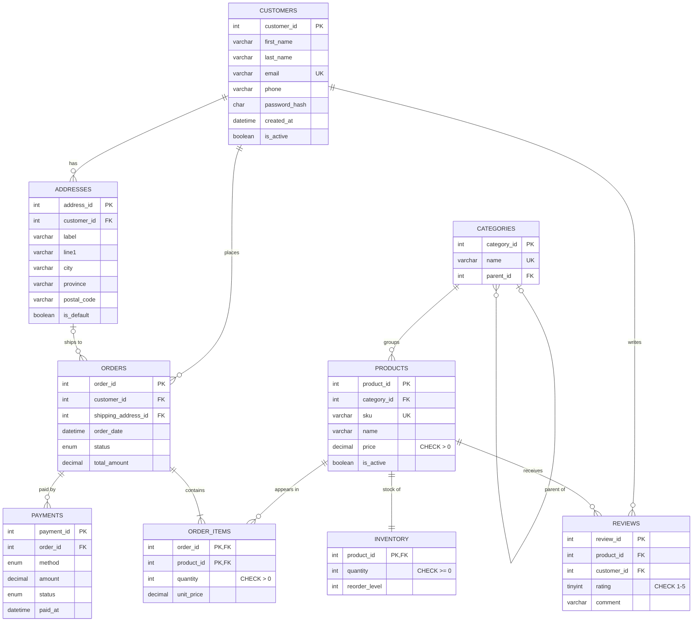

# ER Diagram

Entity-relationship diagram of `ecommerce_db` (GitHub renders the Mermaid block below).

## Relationships

| Relationship | Type | Enforced by |
|---|---|---|
| customer → addresses | 1 : N | `fk_addresses_customer` (ON DELETE CASCADE) |
| customer → orders | 1 : N | `fk_orders_customer` (ON DELETE RESTRICT, order history is kept) |
| category → sub-categories | 1 : N (self) | `fk_categories_parent` |
| category → products | 1 : N | `fk_products_category` |
| product → inventory | 1 : 1 | `inventory.product_id` is both PK and FK |
| orders ↔ products | M : N | resolved by `order_items` (composite PK) |
| order → payments | 1 : N | `fk_payments_order` (allows a failed attempt + a retry) |
| customer ↔ product reviews | M : N | `reviews` with `UNIQUE (product_id, customer_id)` |

## Normalization notes

- The schema is in **3NF**: every non-key column depends only on its table's key.
- `order_items.unit_price` looks like duplication of `products.price` but it is intentional: it is a **snapshot** of the price at the time of the order, so changing a product price later does not change old invoices.
- `orders.total_amount` is a derived value kept in sync by triggers, so reports don't have to re-sum the items each time.
